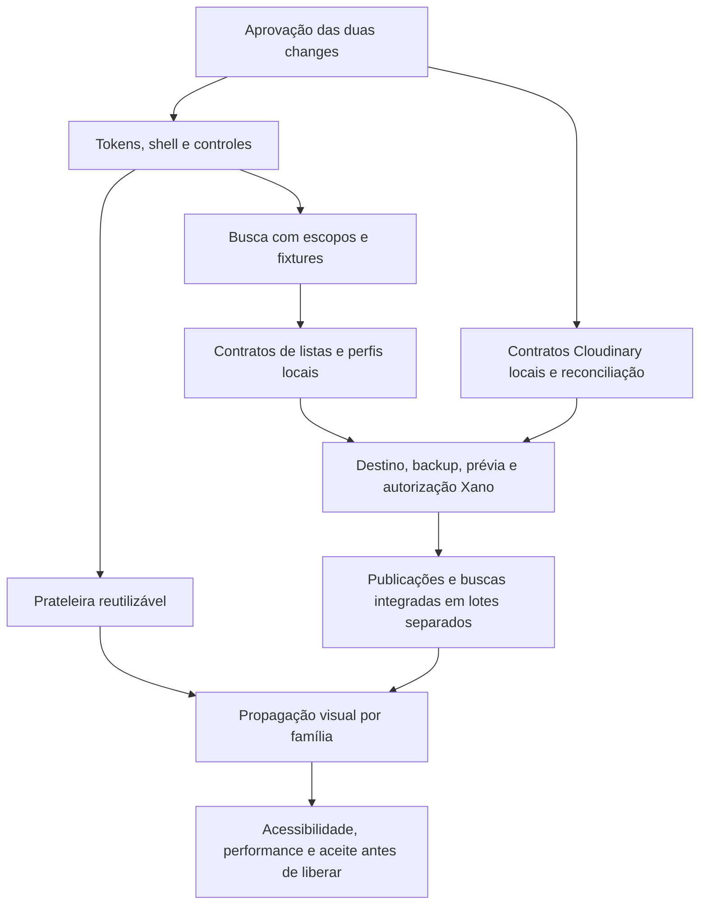

# Planejamento Cloudinary e UI/UX — 11/11/2026

## Resultado e limite da rodada

Pedido atual autoriza **análise e planejamento somente**. Atualizada a change
[hospedar-imagens-publicacoes-cloudinary](../changes/hospedar-imagens-publicacoes-cloudinary/proposal.md)
e criada [modernizar-ui-ux-codeboxd](../changes/modernizar-ui-ux-codeboxd/proposal.md).
Aguardar aprovação das duas antes de implementar. Essa aprovação não substitui
autorizações específicas de publicação, segredos, fixtures, limpeza e ativação.

Nenhuma nova funcionalidade, nova imagem, mutação remota, execução do app,
instalação de dependências, ativação, commit, push, merge ou arquivamento.
Somente documentos em `openspec/` foram editados nesta rodada; código/testes e
ferramenta de ensaio Cloudinary já estavam modificados antes de começar.

## Análise e fontes efetivamente consultadas

- AGENTS.md, README.md, openspec/config.yaml e documentos centrais README,
  CONTEXTO, HISTORICO e PENDENCIAS. Os opcionais docs/project-overview.md e
  docs/domain-model.md não existem na worktree; não foram inventados.
- Rotas Reflex registradas, páginas social/login/account/admin, estados
  social/sessão, transportes e adaptador Cloudinary, CSS e assets ativos.
- Tabelas post/user_list e contratos de posts/feed/lists/profiles/itens públicos,
  specs consolidadas de descoberta, listas e feed, changes de performance,
  administração, logo e mascotes, testes de descoberta/listas/feed/Cloudinary e
  relatórios/logs de validação anteriores.
- Nove arquivos locais encontrados em Imagens. HomePage.png, MoviePage.png e
  captura 2026-09-17 230510 foram visualizados, assim como mascot.png e capturas
  históricas de listas públicas, dashboard mobile e login com Lume. A última
  serve só para distinguir uma entrega revertida, não para sugerir seu retorno.
- Apenas documentação técnica externa: WCAG 2.2 e tentativa de docs ScrollArea.
  Esta última ficou inacessível; wrapper ScrollArea da distribuição instalada
  foi inspecionado. Nenhuma pesquisa externa de inspiração visual.

O diagnóstico por página, redundâncias, referências e limitações está no
[design UI/UX](../changes/modernizar-ui-ux-codeboxd/design.md). Não houve auditoria
visual atual no navegador, testes de toque reais, leitor de tela ou novo acesso
ao Xano/Cloudinary. A análise estática não prova o comportamento remoto atual.

## Estado Cloudinary reconciliado

O escopo de posts já estava nos marcos 2.1/2.2; outra change duplicaria trabalho.
Preservados os IDs e três itens históricos concluídos. A matriz foi expandida
para **3/17 checkpoints** (marcos originais **3/5**, ainda 2.1/2.2 abertos).
Não há aumento de conclusão funcional nesta rodada.

Verificado no estado local:

| Evidência | Conclusão permitida | Não comprova |
| --- | --- | --- |
| Adaptador e regressões não commitados | Verifica recibo/versão/URL e prepara metadados por autor | Associação autorizada/persistida no Xano |
| Log anterior: 632 testes em 25,189 s, OK | Resultado local da rodada anterior está registrado | Nova execução de testes nesta rodada ou aceite remoto |
| Journal privado e relatório anterior: upload/download/destroy 200 e passed=true | PNG sintético foi recuperado com bytes iguais e sua exclusão confirmada | Posts, navegador, nova assinatura endurecida em produção ou invalidação imediata CDN |
| Flag privada conferida como false | Não está ativada nesta máquina | Disponibilidade de endpoints remotos ou configuração de outros colaboradores |

Contrato agora especifica reserva durável, prova independente no servidor,
commit idempotente/atômico, revisão concorrente, metadados aditivos, leitura
legada e remoção explícita. Os onze fluxos pedidos estão na matriz do
[design Cloudinary](../changes/hospedar-imagens-publicacoes-cloudinary/design.md).
Política candidata: carência de 24h para órfãos confirmados/substituídos e lotes
supervisionados de até dez assets; remoção explícita desvincula imediatamente
após commit, sem prometer invalidação instantânea de CDN. Nenhum asset
referenciado, incerto ou legado é apagado por idade, URL ou suposição.

## Principais achados de UI/UX

1. Shell repete Perfil/Meu perfil e deixa Biblioteca/Comunidade no rodapé; a
   descoberta multiformato está embutida na Home sem Pessoas/Listas públicas.
2. Cores equivalentes divergem entre login/social (`#F5B300`/`#f5c810`), controles
   e textos usam escalas dispersas, e mensagens/caixas competem pela atenção.
3. Pares de cores sólidos têm candidatos a baixo contraste: #595959/#030303
   calculado em 2,94:1, #77757d/#0d0d0d em 4,28:1. Não é medição composta do DOM.
4. Prateleiras já têm overflow-x, snap, setas, região focável e tratamento parcial
   de movimento reduzido; falta drag de mouse reutilizável e matriz de interação.
   Não há motivo para reconstruir catálogo ou instalar biblioteca de carrossel.
5. Listas pessoais/públicas e autoria no diretório já existem; faltam busca por
   lista, detalhe endereçável e continuidade das páginas. API de listas públicas
   atual não recebe q; profiles também não. Filtrar só o primeiro lote no cliente
   produziria resultados/totais incorretos e não é a proposta.
6. Os contratos locais de criar lista/save_list não produzem post, e feed lê
   post dos seguidos. O relato de criação de lista no feed ainda não foi
   reproduzido. Manter investigação própria, sem apagar eventos/histórico.
7. Proposta Lume foi revertida; a identidade ativa inclui os mascotes antigos e
   logo preservada. Não reativar Lume por checklist histórico concluído.

## Organização proposta

- **Início:** descoberta editorial e coleções; categorias e busca textual de
  obras continuam diferentes.
- **Buscar:** escopos Obras/Pessoas/Listas públicas, consulta submetida e
  paginação independente na URL; obras mantêm os quatro tipos e relevância.
- **Listas públicas:** título, criador e descrição opcional como critérios;
  criador sempre visível, detalhe estável, perfil e link copiável. Diretório
  continua agrupado por dono; resultados podem ordenar listas por relevância.
- **Feed:** posts/atividades sociais existentes, sem depender dele para encontrar
  listas e sem criar/remover autoposts por hipótese.
- **Biblioteca/perfil/Minhas listas:** acervo e gerenciamento próprios; privadas
  nunca entram na busca pública, inclusive quando a busca é feita pelo dono.

Arrasto proposto: Pointer Events cliente com limiar de intenção 8px, cancelamento
e supressão só do clique pós-arrasto; touch/trackpad nativos preservando vertical
e zoom; setas e teclado mantidos, foco/controles identificados e movimento
reduzido. Zero chamadas ao backend por gesto. Parâmetros são proposta para
aprovação e teste, não implementação entregue.

## Dependências e fronteiras

| Frente | Apresentação/local | Xano/serviço e autorização posterior |
| --- | --- | --- |
| Cloudinary | Adaptador existente, staging/feedback futuro e matriz de erros | Tabela de assets, campos de post, reserva/commit/consulta, guards e segredo de verificação; publicação/ensaio/limpeza/ativação específicos |
| Busca/listas | Escopos, cards, URL de detalhe, retorno à consulta e copiar link | Extensões q/filtros/paginação e projeção pública; novos detalhes público/próprio; ajustar privacidade dos itens; backup/prévia/publicação aprovados |
| Feed | Densidade, foto/obra e diálogo; reutilizar interações | Cloudinary apenas quando seu contrato estiver pronto; atividade de lista é investigação, não remoção autorizada |
| Carrosséis/tokens | Pode avançar depois da aprovação sem mudança de negócio | Nenhuma mutação/consulta nova por gesto ou alteração só visual |
| Administração | Tokens e controles conservando layout e regras | Aceite 9.2 e A2–A4 continuam em gerenciamento-website; redesign não os conclui |
| Performance | Comparar mesmos datasets/viewport/cache, DOM/bytes/requests/tempo | Não redefinir metas, retries, pools, paginação ou 429; medições amplas continuam na change performance |

Homologação Xano segue bloqueada na evidência existente; o usuário confirmou
que não consegue criar outro workspace no painel. Nenhuma compra, nova conta
ou uso de live é consequência automática. Contratos podem ser testados localmente;
publicação e aceite integrados ficam pendentes até destino/escopo aprovados.

## Ordem recomendada por impacto, esforço e risco

| Ordem | Entrega | Esforço/risco relativo | Critério para avançar |
| --- | --- | --- | --- |
| 1 | Aprovar limites, recortes visuais, retenção e mapa de navegação | Pequeno/local | Decisões registradas; não há implementação por inércia |
| 2 | Tokens/contraste, controles e shell em piloto | Pequeno–médio/baixo | Alternativas preservadas, foco/320–390px e nenhum tráfego extra |
| 3 | Drag reutilizável nas prateleiras | Médio/local | Mouse/toque/teclado, sem click acidental e zero backend por movimento |
| 4 | Cloudinary: reserva/validação/commit/limpeza locais | Grande/alto domínio | Invariantes/concorrência/retomada/legado em testes; não tratar como dois ajustes pequenos |
| 5 | Busca/listas: frontend com fixtures e contratos paginados | Médio/privacidade | Nenhuma lista privada exposta, contexto e paginação corretos |
| 6 | Publicações Xano autorizadas por lote e ensaios controlados | Dependência externa/alto | Destino/backup/dry-run/fixtures/limpeza aprovados, evidência real |
| 7 | Propagar padrões para fichas, biblioteca, listas, perfis, auth, feed e por último admin | Médio por família | Sem reconstrução, revisão antes/depois e contratos preservados |
| 8 | Aceite transversal e liberação gradual | Médio | Critérios completos, regressões resolvidas e rollback revisado |

As etapas 2–3 e a preparação local da etapa 4 não dependem de um novo workspace.
Não há necessidade de paralisar toda a UI por causa de Cloudinary. Evitar editar
SocialState/CSS simultaneamente em branches sem revisão de conflitos semânticos.

## Critérios de aceite consolidados

- Cloudinary: onze fluxos do design, duas contas, reservas recuperáveis,
  idempotência/concorrência, legados/rollback e limpeza restrita confirmados em
  evidências distintas de simulação/API/navegador. Marcos 2.1/2.2 só ao final.
- UI/UX: recursos atuais preservados; preto/amarelo e mascotes ativos; busca
  por escopo com retorno/recarga e listas endereçáveis/privadas protegidas.
- Gestos: desktop/touch/tablet, clique normal e cancelamento, teclado/setas,
  foco, ausência de overflow do documento e zero tráfego por movimento.
- Acessibilidade: matriz WCAG 2.2 AA aplicável, 320/390/768/1024/1440px,
  zoom/reflow, contraste, alvos, status e reduced motion; checks manuais junto
  dos automatizados. Não alegar conformidade de todo o app só pelo redesign.
- Performance: mesmos cenários comparados, paginação/caches existentes intactos,
  sem N+1 ou regressão ignorada. Aceite global permanece em performance.

## Git, preservação e validação documental

Estado inicial registrado antes de editar documentos:

| Worktree | Branch/HEAD | Alterações preexistentes |
| --- | --- | --- |
| Codeboxd | task/performance-context-20261109, eb391e6 | Um lockfile modificado |
| .local/worktrees/cloudinary-limites-20261111 | task/cloudinary-limites-20261111, faa655f | Onze entradas, incluindo adaptador/testes e cinco documentos novos |
| Codeboxd-performance-20261109 | task/performance-20261109, a21c806 | Quinze entradas, preservadas |
| .local/worktrees/performance-preservada-20261111 | wip/performance-preservada-20261111, 6aa4777 | Limpa |
| Codeboxd-develop-20261110 | develop, 29d0456 | Limpa |

Histórico local contém PR #34 (handoff) e PR #33; não houve fetch, consulta de PR
ou mudança de referências nesta rodada. Main local permanece 832f728, develop
29d0456; o HEAD da branch de trabalho é faa655f. Não confundir esses estados.

CLI 1.14.3: `new change`, `status`, `instructions`, `list --specs` e validação
foram conferidos na versão instalada. Resultados:

- `openspec validate modernizar-ui-ux-codeboxd --type change --strict`: válido.
- `openspec validate hospedar-imagens-publicacoes-cloudinary --type change --strict`: válido.
- `openspec validate --all`: **33 itens aprovados, zero falhas**; permanecem
  avisos históricos de requisitos longos em administração, media-discovery e
  recuperação. Não foram reescritos fora do escopo.
- Primeiro strict de Cloudinary apontou subtarefas 2.1.x/2.2.x sob grupos 3/4;
  corrigido para subseções do grupo 2, preservando todos os IDs. Revalidação passou.
- `git diff --check -- openspec`: aprovado. Revisão inclui arquivos novos fora do
  índice e ligações locais; não houve staging de código.
- Quinze documentos desta rodada verificados: nenhum link local quebrado,
  whitespace final ou padrão de segredo; também comparados com valores privados
  configurados, sem imprimir ou copiar esses valores.
- Hashes de **1.735 arquivos fora de openspec**, em cinco worktrees, comparados
  antes/depois: idênticos. Flag Cloudinary false. Manifesto privado em
  `.local/planning-cloudinary-uiux-20261111/` da raiz, sem credenciais.
- Testes funcionais/compile/navegador não foram reexecutados porque não houve
  alteração funcional nesta rodada; log de 632 testes é evidência histórica.

UI/UX: **0/26 tarefas**. Cloudinary: **3/17 checkpoints**, sem novo check concluído.
Planejamento completo significa somente artefatos prontos para revisão.

## Arquivos OpenSpec desta rodada

Atualizados: `openspec/README.md`, `openspec/PENDENCIAS.md` e, na change Cloudinary,
`proposal.md`, `design.md`, `tasks.md`, `specs/external-post-images/spec.md`.

Criados na UI/UX: `.openspec.yaml`, `proposal.md`, `design.md`, `tasks.md` e specs
`interface-consistency`, `horizontal-collections`, `unified-search`, `user-lists`.
Criado este relatório. Documentos datados e alterações locais anteriores da
Cloudinary permanecem no mesmo lugar; não foram removidos nem recategorizados
como entregas desta rodada. Nenhum código novo foi escrito.
